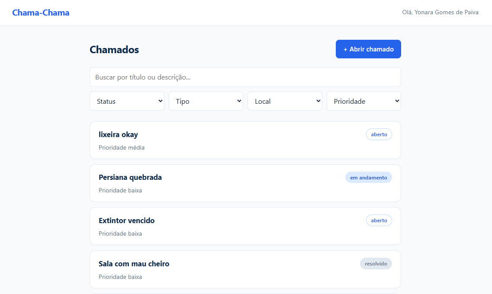

# Chama-Chama

Front-end do Sistema de Chamados de Manutenção do IFRN, campus Pau dos Ferros.
Atividade da disciplina Programação para Internet.

## Tela inicial



## O que o sistema faz

- Mostra o nome do dono da chave no topo
- Lista chamados com busca por texto e filtros de status, tipo, local e prioridade
- Mostra o detalhe de cada chamado em `/chamado/:id`
- Abre e edita chamados com o mesmo formulário (chamados resolvidos não podem ser editados)
- Inicia o atendimento (informando o responsável) e resolve o chamado (informando a solução)
- Exclui chamados com confirmação antes
- Mostra mensagens de carregando, lista vazia e erros vindos da API

## Tecnologias

React, Vite, React Router e Axios.

## Como rodar

1. Instale as dependências:

```bash
   npm install
```

2. Crie um arquivo `.env` na raiz do projeto com a sua chave:

```
   VITE_API_KEY=sua-chave-aqui
```

3. Inicie o servidor:

```bash
   npm run dev
```

## Autora

Yonara Gomes de Paiva, Técnico Integrado em Informática, IFRN Campus Pau dos Ferros.